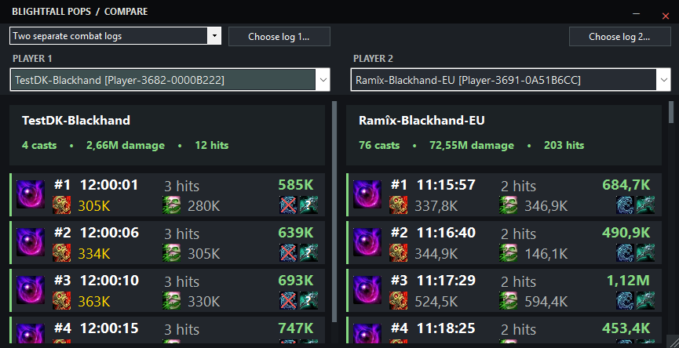

## Compare Mode

Compare Mode lets you inspect Blightfall events side by side. You can compare **two players from the same combat log** or **players from two separate combat log files** (including the same character across different logs).

**How to use Compare Mode:**

1. Open **Compare View** from the main overlay toolbar.
2. Choose whether to compare players from the **same combat log** or **two separate combat logs**.
3. For separate logs, select the combat log file for each side.
4. Select a player for each column using the player dropdowns.
5. Scroll through each column independently and expand an event to inspect its individual hits.

Each side displays Blightfall events with damage totals, hit counts, and the available **Dread Plague (DP)** and **Virulent Plague (VP)** details. Conditional **Festering Scythe (FSC)** and **Soul Reaper (SR)** markers appear where applicable. The comparison window supports resizing and a dark, borderless title bar.

## Overlay Showcase

## Toolbar and settings guide

## Development & AI Assistance

Blightfall Pops is an independently maintained project developed primarily with the assistance of AI-powered coding tools, combined with my own technical understanding, ideas, and practical experience.

While AI has been heavily involved in writing and refining the code, the overall concept, feature design, functionality, testing, bug identification, and development direction are guided by me.

This project also serves as a personal learning experience, allowing me to expand my understanding of software development while creating a useful tool for World of Warcraft players.

I believe in being transparent about the development process and acknowledge the significant role AI assistance has played in bringing this project to life.

## Future Plans & Roadmap

Blightfall Pops is currently focused on tracking specific Death Knight combat mechanics in World of Warcraft. However, I plan to gradually expand its functionality and customization options.

Some features I would like to explore in future updates include:

- **Custom Spell ID Tracking:** Allow users to configure their own Spell IDs and track additional combat events beyond the currently supported abilities.
- **Expanded Visual Customization:** Introduce more options for adjusting the overlay's appearance, including layouts, colors, icons, fonts, and other visual elements.
- **Flexible Event Displays:** Provide additional ways to organize and display tracked combat events based on individual preferences.
- **Improved User Experience:** Continue refining the interface, performance, and overall usability.

These are long-term development ideas rather than guaranteed features or scheduled releases.

As Blightfall Pops is primarily a personal project developed with AI assistance and my own technical understanding, development will happen gradually as I continue learning, experimenting, and improving the application.
